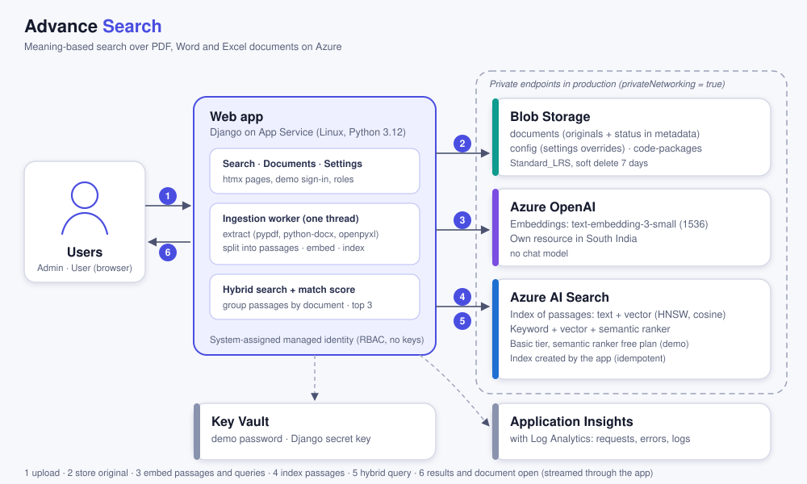
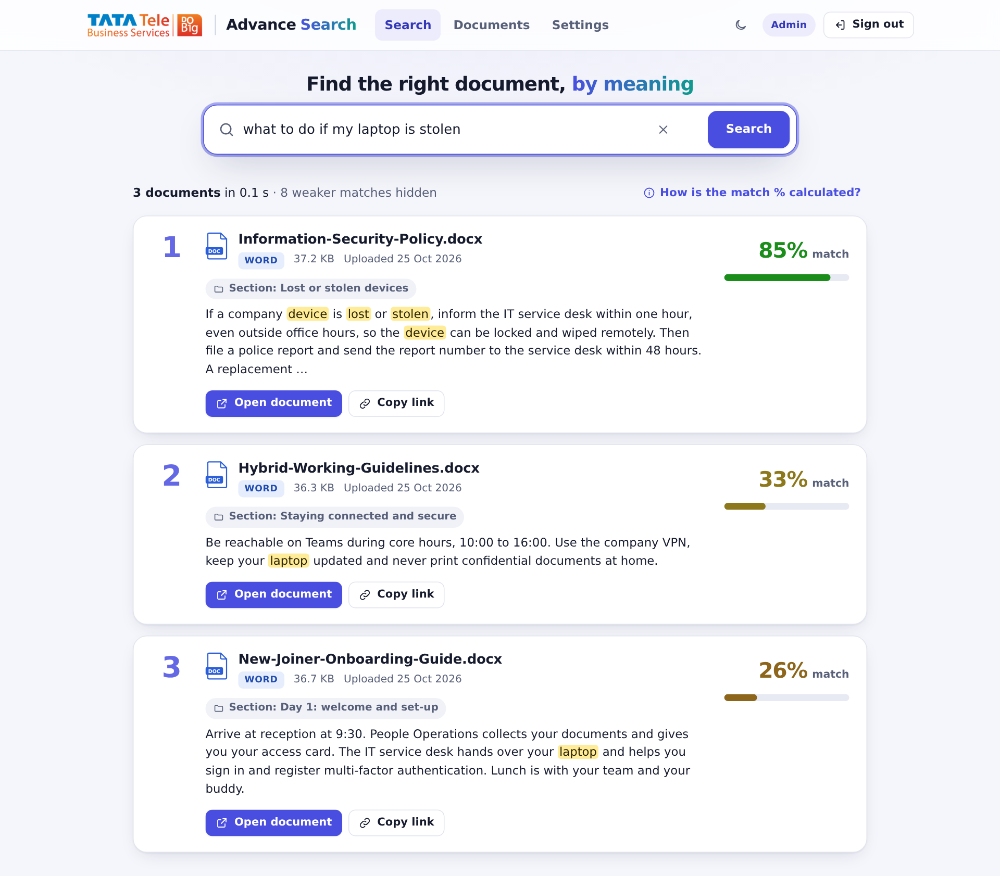
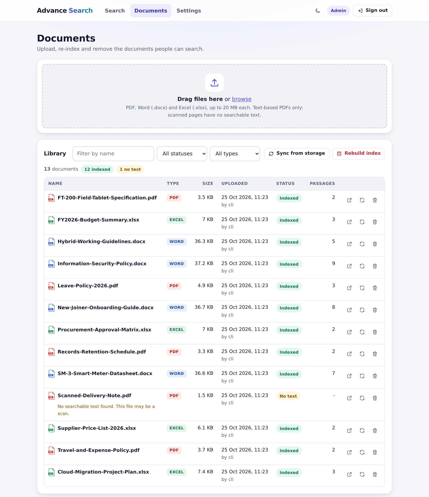

# Advance Search

Find documents by meaning, not just keywords, on Azure. Every document goes through the same steps:

1. The file (PDF, Word or Excel) is uploaded.
2. Its text is extracted and split into passages.
3. Each passage is turned into a vector (embedding) and indexed.
4. A search combines keyword, vector and semantic ranking and returns the top matching documents, each with a match score.

Admins upload and manage documents and change the search settings; Users search and open documents. Both work in a secure web app, where a question such as "how many days off do I get" finds the leave policy even if it never uses those words.

The solution is a deployable template. You choose the tier (SKU) of every Azure service in one parameters file and deploy with one command or the **Deploy to Azure** button.

[](https://portal.azure.com/#create/Microsoft.Template/uri/https%3A%2F%2Fraw.githubusercontent.com%2FTTNS-Deployments%2FAdvance-search%2Fmain%2FDeployment%2FARM%2Fazuredeploy.json/createUIDefinitionUri/https%3A%2F%2Fraw.githubusercontent.com%2FTTNS-Deployments%2FAdvance-search%2Fmain%2FDeployment%2FARM%2FcreateUiDefinition.json)

> The button deploys the infrastructure. The application code is deployed by `Deployment/scripts/deploy.sh` (see [Deployment guide](Documents/deployment-guide.md)). The button only works if this repository is public, or if the template URLs point to a location the portal can read.

### Overview

Every Azure resource is defined in a single ARM template, `azuredeploy.json` (compiled from `azuredeploy.bicep`). SKUs shown are the demo defaults; the dev and prod values are in the [SKU reference](Deployment/README.md).

| # | Name | Description | Service | Template |
|---|------|-------------|---------|----------|
| 1 | Key Vault | Holds the demo password and the Django secret key | Key Vault (standard, RBAC) | azuredeploy.json |
| 2 | Storage | Original documents with their status, settings overrides, code packages | Storage account (StorageV2, Standard_LRS, soft delete 7 days) | azuredeploy.json |
| 3 | Monitoring | Logs and application telemetry | Log Analytics (30 days, 1 GB/day), Application Insights | azuredeploy.json |
| 4 | Embeddings (Azure OpenAI) | Turns passages and queries into vectors | Azure OpenAI `text-embedding-3-small` (1536 dimensions, 10K TPM, own resource in South India) | azuredeploy.json |
| 5 | Search (Azure AI Search) | Passage index with keyword, vector and semantic ranking | Azure AI Search (Basic, 1 replica, 1 partition, semantic ranker free plan) | azuredeploy.json |
| 6 | Web app | Django UI, upload and ingestion, search API | App Service (Linux, Python 3.12) on a new B1 plan, or on an existing plan | azuredeploy.json |
| 7 | Identity and access | Managed identity of the web app with least-privilege roles; data roles for the deploying identity | Role assignments (RBAC, created by ARM) | azuredeploy.json |
| 8 | Private networking (prod) | Private endpoints for Blob, AI Search, Azure OpenAI and Key Vault, VNet integration | VNet, private endpoints, private DNS zones | azuredeploy.json |

Microsoft Entra ID sign-in (an app registration) and Microsoft Defender for Cloud plans are not deployed by the template.

<br/>

## Architecture



| # | Step | Azure service |
|---|------|---------------|
| 1 | An Admin uploads PDF, Word or Excel files on the Documents page (or files are copied straight into the `documents` container) | App Service (Django), Blob Storage |
| 2 | Text is extracted page by page, section by section or sheet by sheet, and split into passages of about 500 tokens | App Service (ingestion worker) |
| 3 | Each passage is turned into a vector | Azure OpenAI (`text-embedding-3-small`) |
| 4 | Passages, vectors and their location (page, section, sheet and rows) are indexed | Azure AI Search |
| 5 | A query runs keyword, vector and semantic ranking in one hybrid search over the top 50 passages | Azure AI Search, Azure OpenAI |
| 6 | Passages are grouped by document; the top 3 documents are shown with a match score, and opened through the app | App Service (Django), Blob Storage |

Ingestion: there is no Function app and no database. The web app runs one background thread that processes one file at a time; each document's status (queued, processing, indexed, failed, no text) is kept in its blob metadata, and an ETag-conditional claim stops two processes from ingesting the same file. On start-up the thread scans the container, which recovers interrupted work and picks up files copied in directly. All service-to-service access uses the web app's **managed identity**, and the only secrets live in Key Vault.

How to use the web app: [User guide](Documents/user-guide.md) · More detail: [Architecture](Documents/architecture.md) · [Technical specification](Documents/technical-specification.md)

<br/>

## Screens

| Search | Documents |
|---|---|
|  |  |

- **Search:** one search bar with example queries and recent searches; the top documents as cards with the best passage highlighted, its location, a match meter and *Open document* / *Copy link*.
- **Documents:** drag-and-drop upload of several files with progress, a table with live status (queued, processing, indexed, failed, no text), filters, re-index, delete, *Sync from storage* and *Rebuild index*.
- **Settings:** number of results, minimum match %, example queries and the welcome text, applied without a redeploy.

The demo uses one shared password; at sign-in you choose a role:

| Role | Access |
|---|---|
| **Admin** | Search, Documents (upload, re-index, delete, sync, rebuild) and Settings |
| **User** | Search and open documents |

<br/>

## Quick start (local mode, no Azure needed)

Local mode replaces every Azure dependency with a local equivalent:

| Azure service | Local replacement |
|---|---|
| Storage | A folder |
| AI Search | SQLite with BM25 keyword ranking and cosine vector similarity, fused with reciprocal rank fusion; a stand-in for the semantic ranker |
| Azure OpenAI embeddings | Deterministic mock embeddings (words, related terms and character n-grams) |
| Key Vault and sign-in | Environment variables; sign in with a role choice (`AUTH_MODE=dev`) or a demo password |

```bash
make setup     # creates .venv and installs everything (Python 3.12 recommended)
make seed      # indexes the 13 sample documents in Data/sample_docs
make run       # http://localhost:8000 – choose Admin or User
make test
```

Without `make`:

```bash
python3 -m venv .venv && . .venv/bin/activate
pip install -r requirements-dev.txt
python -m advancesearch seed
cd Code/webapp && python manage.py runserver
```

**Moving to real services:** copy `.env.example` to `.env` and set the variables for one service at a time, for example `EMBEDDING_BACKEND=azure` with `AZURE_OPENAI_ENDPOINT` and `EMBEDDING_DEPLOYMENT`, or `SEARCH_BACKEND=azure` with `SEARCH_ENDPOINT`. Everything else stays local. The `make` targets load `.env`; when you run Python directly, export the variables in your shell instead. See [Local development](Documents/local-development.md) and [Configuration](Documents/configuration.md).

Docker alternative: `make docker-up` runs the web app with the Azurite storage emulator.

<br/>

## Deploy to Azure

1. **Choose SKUs.** Edit [`Deployment/ARM/parameters/demo.parameters.json`](Deployment/ARM/parameters/demo.parameters.json), `dev.parameters.json` or `prod.parameters.json`. Every tier and size is a parameter; see the [SKU reference](Deployment/README.md).
2. **Deploy** infrastructure and code from Azure Cloud Shell (Bash). The demo (existing resource group, shared App Service plan, sample documents) needs one command; choose the password yourself:
```bash
   cd ~ && git clone https://github.com/TTNS-Deployments/Advance-search.git ; cd ~/Advance-search && git pull && Deployment/scripts/deploy.sh -e demo --param demoPassword='<choose-a-password>'
```
   Other environments: `Deployment/scripts/deploy.sh -e dev -g <resource-group> --param demoPassword='...'`, or `-e prod` (private networking; run the code step from inside the network).
3. Open the web app URL printed at the end and sign in: choose **Admin** or **User** and enter the shared demo password. It is set once; later runs without `--param demoPassword` keep it.
4. Upload documents on the **Documents** page, or let `--seed` (on by default for the demo) copy the sample documents into storage; the app indexes them within a few minutes of start-up.
5. Optional: change the AI Search tier or replicas in the parameters file and run the deployment again; for production, set `privateNetworking` to `true` (already set in `prod.parameters.json`).

Full steps, the quota check, CI/CD with GitHub Actions and troubleshooting are in the [Deployment guide](Documents/deployment-guide.md).

<br/>

## Repository layout

| Path | Contents |
|---|---|
| [`Code/core`](Code/core) | `advancesearch` Python package: extraction, chunking, embeddings (mock and Azure OpenAI), index (local and Azure AI Search), search and scoring, ingestion worker, settings, CLI, tests |
| [`Code/webapp`](Code/webapp) | Django web app: demo sign-in and roles, Search, Documents and Settings pages, JSON API, templates, CSS and JavaScript |
| [`Config`](Config) | `search.yaml`: result count, minimum match %, example queries, welcome text, passage sizes, related terms |
| [`Data/sample_docs`](Data/sample_docs) | 13 generated sample documents (PDF, Word, Excel), the generator and the evaluation queries |
| [`Deployment/ARM`](Deployment/ARM) | ARM template (Bicep source and compiled JSON), per-environment SKU parameter files, portal form for the Deploy button |
| [`Deployment/scripts`](Deployment/scripts) | `deploy.sh`, `deploy_code_arm.sh`, `package.sh` |
| [`Deployment/environments`](Deployment/environments) | Deployment variables per environment (`demo.env`) |
| [`Documents`](Documents) | Architecture, technical specification, deployment guide, configuration, local development, user guide |
| [`qa`](qa) | Test cases, test report, browser tests (Playwright) and repository checks |
| [`.github/workflows`](.github/workflows) | CI (tests, template validation, package) and Deploy (manual, per environment) |

<br/>

## Status and roadmap

| Phase | Scope | Status |
|---|---|---|
| 1 | Upload, extraction (PDF, Word, Excel), hybrid search with top-3 results and a match score, document management, settings, demo sign-in | Implemented and verified **locally only** (local mode, the packaged app under gunicorn, Blob code against the Azurite emulator, scripts against a fake `az`). **Not yet run on Azure**: the ARM deployment, Azure AI Search, Azure OpenAI embeddings and the Cloud Shell scripts are untested there |
| 2 | Microsoft Entra ID sign-in with real roles and per-department access, OCR for scanned PDFs, more file types, answer generation from the top passages | Planned |

The language is English: the search index uses the `en.microsoft` analyzer, and the sample documents and evaluation queries are English. Only text-based files are searchable (a scanned PDF shows *No text*), and uploads are limited to 20 MB per file (`maxUploadMb`).

<br/>

## Support

See [SUPPORT.md](SUPPORT.md). Security issues: [SECURITY.md](SECURITY.md).
